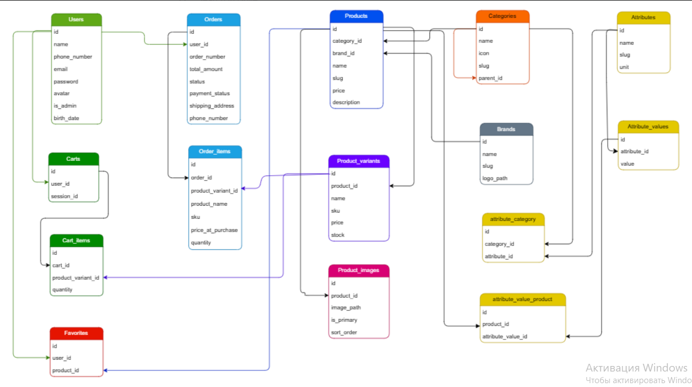

# Texmart

An electronics and home-appliance store for the Uzbek market: a Nuxt 4 storefront on
top of a Laravel 13 JSON API, with a Filament admin panel.

Portfolio project. Not affiliated with any real shop.

## Stack

| Layer | Technology |
|---|---|
| Frontend | Nuxt 4 (Vue 3, SSR), TypeScript, Tailwind CSS v4, Pinia |
| Backend | Laravel 13, PHP 8.5, Sanctum token auth |
| Database | MySQL |
| Admin | Filament 5, at `/admin` |
| Queue | Laravel queues (database driver), used for order confirmation email |
| Tests | Pest: 48 tests, 199 assertions |

## Repository layout

| Path | What it is |
|---|---|
| `frontend/` | Nuxt storefront: catalog, filters, product page, cart, checkout, cabinet |
| `backend/` | Laravel API (`/api/v1`), Filament admin, seeders, Pest tests |
| `docs/` | ERD |

## Database



Products carry no attributes directly. An attribute (RAM, colour…) belongs to categories
through `attribute_category`, its possible values live in `attribute_values`, and a product
is linked to the values it has through `attribute_value_product`. That shape is what makes
the faceted filtering below possible. Prices and stock live on `product_variants`, and
`order_items` copies the name, SKU and price at purchase, so old orders never change when
a product does.

## Running it locally

You need PHP 8.3+, Composer, MySQL and Node.js.

**Backend** (create an empty MySQL database first, and put its credentials in `.env`):

```bash
cd backend
composer install
cp .env.example .env
php artisan key:generate
php artisan migrate --seed
php artisan storage:link
php artisan serve
```

The API runs at `http://localhost:8000/api/v1`. Order confirmation emails go through the
queue, so in a second terminal:

```bash
php artisan queue:work
```

**Frontend:**

```bash
cd frontend
cp .env.example .env
npm install
npm run dev
```

The store runs at `http://localhost:3000`. `.env` points it at the API:

```bash
NUXT_PUBLIC_USE_MOCKS=false
NUXT_PUBLIC_API_BASE=http://localhost:8000/api/v1
```

Setting `NUXT_PUBLIC_USE_MOCKS=true` runs the frontend on its bundled JSON fixtures, with
no backend at all.

**Tests:**

```bash
cd backend
php artisan test
```

## Interesting problems I solved

### 1. A guest cart that survives login

Guests can shop without an account, but carts belong to users. The cart has to follow the
guest into their account when they sign up or log in.

Each guest gets a UUID cart token, sent on every request in an `X-Cart-Token` header.
`CartService::getOrCreateCart()` finds the cart by user when signed in, or by token when
not. On register or login, `mergeGuestCart()` moves the guest's items into the user's cart
inside one transaction. An item already in the user's cart gets the quantities added
together, and stock is checked against the combined total:

```php
// backend/app/Services/CartService.php
public function mergeGuestCart(User $user, string $cartToken)
{
    return DB::transaction(function () use ($user, $cartToken) {
        $guestCart = Cart::where('session_id', $cartToken)
            ->whereNull('user_id')
            ->with('cartItems')
            ->first();

        if (!$guestCart) {
            return null;
        }

        $userCart = Cart::firstOrCreate(['user_id' => $user->id], ['session_id' => null]);

        foreach ($guestCart->cartItems as $guestItem) {
            $existingItem = $userCart->cartItems()
                ->where('product_variant_id', $guestItem->product_variant_id)
                ->first();

            $variant = ProductVariant::findOrFail($guestItem->product_variant_id);
            $totalQuantity = ($existingItem?->quantity ?? 0) + $guestItem->quantity;

            if ($totalQuantity > $variant->stock) {
                throw ValidationException::withMessages([
                    'quantity' => 'Mahsulot miqdori mavjud zaxiradan oshib ketdi.',
                ]);
            }

            if ($existingItem) {
                $existingItem->increment('quantity', $guestItem->quantity);
            } else {
                $guestItem->update(['cart_id' => $userCart->id]);
            }
        }

        $guestCart->delete();

        return $userCart->load('cartItems');
    });
}
```

Two bugs I hit along the way:

- **The token wasn't persisted on the frontend**, so every reload started a new empty guest
  cart. It is now kept in `localStorage` and sent with every cart request.
- **A quantity above current stock couldn't be lowered.** If stock dropped below what was in
  the cart, the stock check rejected *every* change, including the decrease that would fix
  it. The rule is now to reject only increases past stock:

```php
// backend/app/Services/CartService.php: updateItem()
if ($quantity > $cartItem->quantity && $quantity > $variant->stock) {
    throw ValidationException::withMessages([
        'quantity' => "So'ralgan miqdor mavjud zaxiradan oshib ketdi.",
    ]);
}
```

### 2. Faceted filtering with live facet counts

The catalog filters by category (including subcategories), brand, price, stock and
attribute values. Every attribute option also shows how many products match, for
example `8 GB (12)`.

The query is built from conditional `when()` clauses. A category filter matches the
category and its children:

```php
// backend/app/Http/Controllers/Api/ProductController.php: index()
$query->when($request->filled('category'), function ($q) use ($request) {
    $categories = (array) $request->category;

    $parentIds = Category::whereIn('slug', $categories)->pluck('id');
    $childIds = Category::whereIn('parent_id', $parentIds)->pluck('id');

    $q->whereIn('category_id', $parentIds->merge($childIds));
});
// ... brand, min_price, max_price and in_stock follow the same pattern
```

The important line is where the query is **cloned**: after every other filter, but
*before* the attribute filter is applied.

```php
$filteredProductIds = (clone $query)->pluck('products.id');

$facets = AttributeValue::with('attribute')->withCount([
    'product as product_count' => function ($q) use ($filteredProductIds) {
        $q->whereIn('products.id', $filteredProductIds);
    },
])->get();

$query->when($request->filled('attribute_values'), function ($q) use ($request) {
    $q->whereHas('attributeValue', function ($attributeQuery) use ($request) {
        $attributeQuery->whereIn('attribute_values.id', $request->input('attribute_values'));
    });
});
```

Why there: if the counts were taken after the attribute filter, ticking `8 GB` would
make every other RAM option count zero, and the user could never widen their selection.
Cloning at that point means the counts respond to category, brand, price and stock, but
not to the attribute selection itself. `withCount` computes every count in a single query
instead of one query per attribute value, so there is no N+1.

One known trade-off: the counts ignore *all* attribute selections, not just the facet's
own group. Picking a colour doesn't narrow the RAM counts. Fixing that means one count
query per attribute group.

### 3. Checkout as one atomic transaction with row locking

Two customers buying the last unit at the same moment must not both succeed, and an order
must never be left half-created.

`OrderController::store()` does the whole checkout inside `DB::transaction`. Each variant
is locked with `lockForUpdate()`, so a concurrent checkout of the same item waits for this
one to finish instead of reading the same stock:

```php
// backend/app/Http/Controllers/Api/OrderController.php: store()
$order = DB::transaction(function () use ($user, $validated) {
    $cart = Cart::where('user_id', $user->id)->with('cartItems')->first();
    // ... empty-cart check

    $totalAmount = 0;

    foreach ($cart->cartItems as $cartItem) {
        $variant = ProductVariant::where('id', $cartItem->product_variant_id)
            ->lockForUpdate()
            ->firstOrFail();

        if ($cartItem->quantity > $variant->stock) {
            throw ValidationException::withMessages([
                'cart' => 'Mahsulot zaxirasi yetarli emas.',
            ]);
        }

        $totalAmount += $variant->price * $cartItem->quantity;
    }

    // ... generate a unique order number, then Order::create([...])

    foreach ($cart->cartItems as $cartItem) {
        $variant = ProductVariant::findOrFail($cartItem->product_variant_id);

        OrderItem::create([
            'order_id' => $order->id,
            'product_variant_id' => $variant->id,
            'product_name' => $variant->product->name,
            'sku' => $variant->sku,
            'price_at_purchase' => $variant->price,
            'quantity' => $cartItem->quantity,
        ]);

        $variant->decrement('stock', $cartItem->quantity);
    }

    $cart->cartItems()->delete();

    return $order;
});

SendOrderConfirmationEmail::dispatch($order);
```

- **The total comes from database prices**, never from the request, so a client cannot
  submit its own price.
- **`price_at_purchase` is a snapshot**, so a later price change doesn't rewrite past orders.
- **Any failure rolls everything back.** Running out of stock, or any exception, undoes the
  order, its items, the stock changes and the cart clear together.
- **The confirmation email runs on the queue**, dispatched after the transaction commits.
  A slow mail server never holds the row locks or delays the response.

### Bonus: what the tests caught

The Pest suite (48 tests) found two real bugs:

- **The compare page silently lost its variants.** `compare()` eager-loaded `'ProductVariant'`
  with a capital P, but the relation is `productVariant`.
- **`OrderPolicy::view()` let any signed-in user see any order.** The check was
  `$user->id || $user->id === $order->user_id`. `$user->id` is always truthy, so the second
  half never mattered. It is now:

```php
// backend/app/Policies/OrderPolicy.php
public function view(User $user, Order $order): bool
{
    return $user->id === $order->user_id || $user->is_admin;
}
```

## Out of scope

Real payment gateway, multiple vendors, loyalty points, live chat, mobile app.
